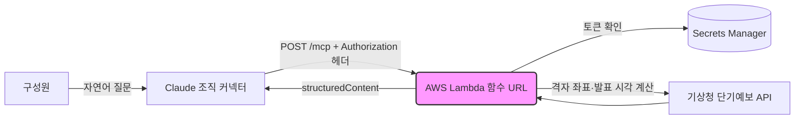

# 🌦️ 기상청 날씨 MCP 서버 — 사내 Claude에서 대화로 날씨 조회

AWS Lambda(Python)로 원격 MCP(Model Context Protocol) 서버를 직접 구현해, 사내에서 쓰는
Claude가 기상청 데이터를 바로 조회하도록 만든 프로젝트입니다. 앞 단계(Phase 4)의
Snowflake MCP는 이미 만들어진 서버를 연동한 것이고, 이 프로젝트는 서버 자체를 만든 것입니다.

---

## 🤔 왜 이걸 시작했나

세탁 수요는 비·눈·기온의 영향을 크게 받아서, 마케팅팀은 프로모션과 푸시 일정을 잡을 때
날씨를 함께 봐야 했습니다. 그런데 날씨는 매번 사람이 기상청 사이트를 따로 열어 확인하는
구조였습니다. 회사가 이미 Claude를 전사 AI 도구로 쓰고 있었기 때문에, Claude에게 물으면
바로 답하도록 날씨 조회를 하나의 도구로 붙이기로 했습니다.

---

## 💡 프로젝트 배경

### 1. 해결하고자 한 문제
- 날씨 확인이 별도 사이트를 오가는 수작업으로 이뤄짐
- 기상청 API는 격자 좌표, 발표 시각, 코드값(하늘상태·강수형태)을 알아야 쓸 수 있어 비개발 직군이 직접 쓰기 어려움

### 2. 설계 방향
- 기상청 단기예보 API를 감싼 도구 2종을 MCP 서버로 제공
  - `get_current_weather`: 현재 날씨 (초단기실황, 매시간)
  - `get_short_forecast`: 시간별·일별 예보 (단기예보, 하루 8회 발표)
- 외부 패키지 없이 표준 라이브러리와 boto3만 써서 zip 하나로 배포
- 상태를 유지하지 않는 Streamable HTTP(JSON 응답) 방식으로 구현해 Lambda와 맞춤

### 3. 왜 Lambda였나
상시 서버를 띄울 만큼 호출량이 많지 않고, 기존 배치들도 Lambda로 운영하고 있어 운영 방식을
통일할 수 있었습니다. 함수 URL로 별도 API Gateway 없이 엔드포인트를 열 수 있다는 점도 컸습니다.

---

## 🏗️ 아키텍처

---

## 🔐 보안 설계 (정보보호팀 협의)

외부에서 호출 가능한 공개 엔드포인트라서 설계 단계부터 정보보호팀과 협의했고, 받은 조건을
코드와 인프라에 모두 반영했습니다.

| 조건 | 반영 방식 |
|---|---|
| 비밀값 분리 | 기상청 키와 접근 토큰은 Secrets Manager에만 보관 (코드·환경변수에 없음) |
| 토큰 전달 경로 제한 | `Authorization: Bearer` 헤더로만 받고, URL 경로·쿼리 토큰은 받지 않음 |
| 타이밍 공격 방지 | 토큰 비교에 고정시간 비교(`hmac.compare_digest`) 적용 |
| 로그 노출 방지 | 키·토큰·요청 헤더·기상청 요청 URL은 로그에 남기지 않고, 오류 메시지도 가림 처리 |
| 엔드포인트 은닉 | 토큰이 없거나 틀리면 404로 응답해 엔드포인트 존재 자체를 드러내지 않음 |
| 남용 방지·운영 | 예약 동시성 제한, 로그 보존 기간 설정, IAM 최소 권한 |

---

## 📊 성과

- 구성원이 Claude에서 "서울이랑 부산 지금 날씨 알려줘"처럼 대화로 날씨를 조회할 수 있게 됨
- 조직 커넥터로 등록해 개별 설정 없이 누구나 연결 가능
- 배포 후 정상 응답, 토큰 없는 요청 차단, 실제 기상 데이터 응답을 단계별로 검증

---

## 🛠️ 설계 포인트와 예외 처리

### 1. 발표 시각 보정
기상청 자료는 발표 직후 바로 제공되지 않습니다. 초단기실황은 정시 자료가 40분 이후 제공되어
45분을 기준으로, 단기예보는 발표 후 약 10분 뒤 제공되어 15분을 기준으로 최신 발표 시각을
고르도록 했습니다. 새벽 2시 이전에는 전날 23시 발표분을 씁니다.

### 2. 일 최저·최고기온 누락 보완
발표 시각에 따라 기상청 일 최저(TMN)·최고(TMX)기온이 비어 있는 날이 있습니다. 이때는 남은
시간대의 시간별 기온으로 계산하고, `temp_from_hourly` 플래그로 기상청 공식값이 아님을 표시해
AI가 답변할 때 구분할 수 있게 했습니다.

### 3. 비정상 응답 처리
키 오류 같은 기상청 오류는 JSON이 아니라 XML로 옵니다. JSON 파싱 실패를 별도로 잡아 원인을
알 수 있는 메시지를 돌려주되, 메시지 안의 키·토큰은 가림 처리했습니다. 도구 실행 실패는
프로토콜 오류가 아니라 `isError`로 돌려줘 AI가 실패를 인지하고 사용자에게 설명할 수 있게 했습니다.

### 4. 호출량 절감
같은 발표 시각·같은 지역 요청은 30분간 컨테이너 메모리에 저장해 재사용합니다. 컨테이너가
새로 뜨면 캐시가 비는 한계가 있지만, 이 서비스의 호출량에서는 충분하다고 판단했습니다.

---

## 📁 파일

- `lambda_function_masked.py`: MCP 서버 코드 (사내 식별 정보 마스킹)

## 🛠️ Tech Stack

`AWS Lambda` `Python 3.12` `MCP (Streamable HTTP)` `AWS Secrets Manager` `기상청 단기예보 API` `Claude`
