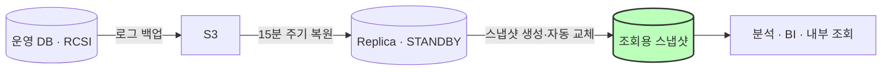

# 🗄️ 05. 운영 DB 조회 분리와 인프라 비용 최적화

DBA 업무를 함께 맡으며, 운영 DB(MSSQL)로 몰리던 분석·조회 트래픽을 읽기 전용 Replica로
분리하고, 그 과정과 이후 운영에서 발견한 클라우드 비용 이상을 추적해 줄인 프로젝트입니다.
(2026.09 ~ 2026.10)

---

## 🤔 왜 이걸 시작했나

분석, BI(Metabase), 내부 조회가 모두 운영 DB에 직접 접속하고 있었습니다. 조회가 몰리면 운영
부하가 커지고 락 위험도 있었는데, 실제로 오래 열린 트랜잭션 하나가 서버 전체 블로킹으로 번지는
장애가 반복됐습니다. 조회와 운영을 분리하지 않으면 같은 장애가 계속될 거라고 판단했습니다.

---

## 💡 프로젝트 배경

### 1. 해결하고자 한 문제
- 분석·BI 조회가 운영 DB에 직접 붙어 생기는 부하와 락 위험
- 오래 열린 트랜잭션이 서버 전체 블로킹으로 번지는 장애
- 인프라 비용 중 원인을 모른 채 새고 있는 항목

### 2. 조회용 Replica 설계
- **로그 쉬핑 기반 읽기 전용 Replica**: 운영 DB의 로그 백업을 S3를 거쳐 15분 주기로 복원하는 구조로 설계했고, 개발 환경 리허설로 검증한 뒤 운영에 적용했습니다.
- **조회 끊김 해결**: STANDBY 방식은 복원할 때마다 조회 세션이 끊기는 한계가 있습니다. DB 스냅샷 계층과 자동 교체 작업을 더해, 사용자는 항상 같은 이름의 스냅샷에 접속하도록 했습니다.
- **운영 DB 블로킹 해소**: RCSI(Read Committed Snapshot Isolation)를 적용해 읽기와 쓰기 사이의 락 충돌을 없앴습니다.

### 3. 인프라 비용 최적화
- **NAT 비용 이상 추적**: 클라우드 비용 리포트에서 NAT 처리 비용이 월 $2.6K 늘어난 것을 발견했습니다. 네트워크 지표를 따라가 보니, 동기화 스크립트가 이미 삭제된 파일 약 4,800개(15GB)를 10분마다 다시 내려받는 설계 결함이 있었습니다. 동기화 범위를 최근 파일로 한정해 수정했습니다.
- **유휴 DMS 인스턴스 정리**: 멈추거나 실패한 상태로 남아 있던 복제 인스턴스 2대를 조사했습니다. CloudTrail로 생성 담당자를 확인하고, 복제 대상 DB와 Kafka 토픽·컨슈머를 따라가며 실제로 쓰는 곳이 있는지 검증했습니다. 영향이 없다는 걸 확인한 뒤 삭제했고, 이 과정에서 두 달째 조용히 끊겨 있던 Kafka 파이프라인도 발견했습니다.

---

## 🏗️ 아키텍처

---

## 📊 성과

- 조회 트래픽을 운영 DB에서 분리하고, 최대 15분 지연의 조회 전용 DB를 제공
- Replica 수신 트래픽 10분당 15GB → 0.01GB (99.9% 감소), NAT 추가 비용 월 약 $2.6K 제거
- 유휴 DMS 인스턴스 정리로 월 약 $410 절감 (비용 최적화 합계 월 약 $3K)
- 구축 과정, 장애 사례, 운영 가이드를 사내 문서로 남겨 인수인계가 가능한 체계로 정리

---

## 🛠️ Troubleshooting

### 1. 로그 체인 단절로 복원이 6일간 멈춘 장애
- **문제**: 수동 로그 백업이 한 번 실행되면서 로그 체인이 끊겨, Replica 복원이 6일간 멈췄습니다.
- **해결**: 누락된 백업 파일을 추적해 순서대로 이어 붙여 데이터 손실 없이 복구했습니다.
- **재발 방지**: 수동 로그 백업 금지, 필요할 때는 `COPY_ONLY`로만 백업한다는 운영 수칙을 문서화했습니다.

### 2. 복원용 DB에 사용자가 직접 접속하는 문제
- **문제**: 사용자가 스냅샷이 아니라 복원 대상 DB에 직접 접속하면서 복원 작업과 충돌했습니다.
- **해결**: DB를 재구축하고 접근 경로를 분리해, 사용자는 조회용 스냅샷에만 접속하도록 했습니다.

### 3. 지우기 전에 사용처부터 검증하기
- **문제**: 유휴로 보이는 DMS 인스턴스도 어딘가에서 쓰고 있을 수 있어 바로 지울 수 없었습니다.
- **해결**: 생성 이력(CloudTrail), 복제 대상, Kafka 토픽과 컨슈머를 차례로 따라가 실제 사용처가 없음을 확인한 뒤에만 삭제했습니다.

---

## 🛠️ Tech Stack

`MSSQL` `로그 쉬핑` `DB 스냅샷` `RCSI` `AWS S3` `AWS DMS` `CloudTrail` `Metabase`
